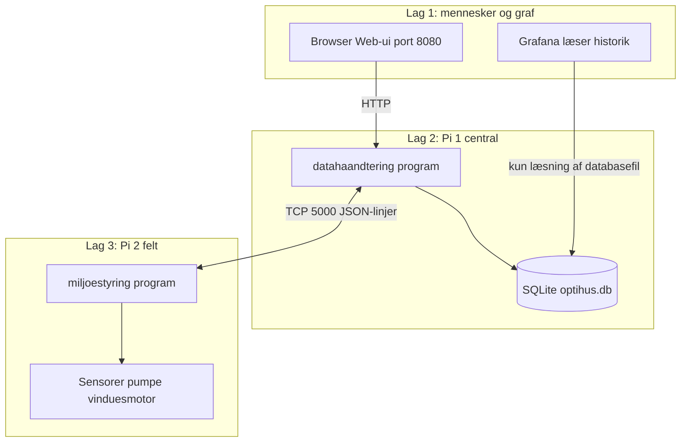

# Optihus: fuld forklaring på dansk

Denne tekst er til dig, der vil forstå systemet uden at være IT-specialist. Den beskriver, hvad koden og mapperne gør i praksis, og hvor der er begrænsninger eller risiko.

**Formatering:** Der bruges almindeligt dansk tegnsæt og tastaturvenlige tegn (ingen pile, ingen tankestreg som erstatning for komma, ingen grad-tegn; temperatur skrives som ord).

---

## 1. Hvad er Optihus?

Optihus er et lille styringssystem til et drivhus eller en lignende kasse med planter. To computer-enheder (typisk to Raspberry Pi) arbejder sammen:

- **Pi 1** samler data, gemmer historik, tilbyder en webside til mennesker og sender ordrer ud til felt-enheden.
- **Pi 2** sidder tæt på hardware: den måler og kan tænde eller slukke for pumpe og vinduesmotor.

Tanken er: **én fast net-forbindelse** mellem de to, så Pi 2 altid ved, hvilke grænser den skal holde, og Pi 1 kan vise status og gemme målinger.

---

## 2. Korte begreber (ordliste)

| Udtryk | Simpel betydning |
|--------|------------------|
| **TCP** | En pålidelig net-forbindelse, der forbliver åben, mens programmerne kører. Som en telefonlinje, hvor begge ved, hvem der taler. |
| **Port 5000** | Et nummer på Pi 1, så netværket ved, hvilken "dør" der åbnes til styring og data mellem Pi 1 og Pi 2. |
| **Port 8080** | Et nummer på Pi 1 til **websiden** i browseren (mennesker bruger den). Den er **ikke** den samme som 5000. |
| **JSON** | Tekstformat til beskeder: strukturerede felter som "temperatur": 22.5. Nemt for programmer at læse. |
| **JSON-linje** | Én komplet besked pr. linje tekst. Hver linje er ét brev mellem programmerne. |
| **SQLite / database** | En fil på Pi 1 (`optihus.db`), hvor målinger og indstillinger gemmes. Ikke en sky; bare en fil på disk. |
| **Konfiguration** | De valg, der er gemt: hvilke afgrødeprofiler, hvordan plantekasser er sat, hvor ofte der sendes data, og om der er nødstop. |
| **Telemetri** | Målinger sendt fra Pi 2 til Pi 1 (temperatur, fugtighed, pumpe på eller ej, osv.). |
| **Kommando** | Besked fra Pi 1 til Pi 2 (fx "her er ny konfiguration" eller "nødstop"). |
| **Hardware** | Fysiske dele: sensorer, pumpe, motor, ledninger. |

---

## 3. Struktur og overblik (tre lag, diagrammer)

Dette kapitel er **landkortet**. Det forklarer, hvordan de store dele hænger sammen, før du dykker ned i mapper og filnavne.

### Tre lag oven på hinanden

Forestil dig systemet som tre lag:

1. **Mennesker og graf-visning:** Du bruger **websiden** på Pi 1 (port **8080**). **Grafana** er et ekstra vindue til **kun at se historik** som kurver fra databasen. Grafana sender **ikke** ordrer til planter eller motor.
2. **Central computer (Pi 1):** Programmet **datahaandtering** holder net-forbindelsen til Pi 2, gemmer målinger og indstillinger i **SQLite**, og kan sende **kommandoer** til Pi 2 (fx ny konfiguration eller nødstop).
3. **Feltcomputer (Pi 2):** Programmet **miljoestyring** sidder fysisk tæt på drivhuset. **Det** måler og **tænder eller slukker** for pumpe og vinduesmotor ud fra grænser, det har fået fra Pi 1.

**Kritisk:** Den direkte styring af pumpe og motor sker på **Pi 2**. Pi 1 er den centrale **logbog og kontrolpult** for mennesker og for at samle historik. Hvis netværket mellem Pi 1 og Pi 2 falder, kan Pi 2 **ikke** få opdaterede grænser, før forbindelsen er tilbage (den kan stadig køre videre med sidste kendte tal og lokale loops).

### Figur: hvem taler med hvem (tekstdiagram)

```text
                    Din browser
                         |
                  HTTP, port 8080
                         |
               +---------v----------+
               | Pi 1               |
               | programmet         |
               | datahaandtering    |
               | og databasen       |
               | SQLite (fil)       |
               +---------+----------+
                         |
              TCP, port 5000
              beskeder som tekstlinjer
              med JSON pr. linje
                         |
               +---------v----------+
               | Pi 2               |
               | programmet         |
               | miljoestyring      |
               +---------+----------+
                         |
                  kabler på stedet
                         |
               sensorer, pumpe, motor

Grafana (hvis I bruger den): læser typisk **samme** SQLite-fil som Pi 1-programmet.
Grafana er **ikke** en del af styringen af planter.
```

### Figur: samme idé som diagram (Mermaid)

På **GitHub** og **GitLab** vises Mermaid-blokke automatisk, når I åbner filen i browseren. Danske bogstaver (æ, ø, å) i etiketter virker fint dér. Figuren her svarer til tekstdiagrammet ovenfor:



### Figuren inde i Pi 1-programmet (groft)

Pi 1-kørslen er **ikke** én stor blok; den har **flere spor**, der mødes om databasen og om net-tråden til Pi 2:

```text
Fra Pi 2 kommer tekstlinjer ind  -->  tcp_server  -->  kø  -->  app
                                                               |
                                                               +--> telemetri går til telemetry_processor (baggrundstråd)
                                                               |         |
                                                               |         +--> database_manager  -->  SQLite
                                                               |
                                                               +--> andre beskeder kan også kalde database_manager

Browser/Web-ui  -->  web_ui_server  -->  database_manager  -->  SQLite
                           |
                           +--> når du gemmer konfiguration: command_dispatcher  -->  besked ud  -->  tcp_server sender til Pi 2
```

Formålet med **telemetry_processor** og **køer** er, at langsomme database-skrivninger **ikke** må stoppe den hurtige net-tråd (det er et stabilitetsvalg i koden).

### Figuren inde i Pi 2-programmet (groft)

```text
miljoestyring_config.json (server adresse og port)
            |
            v
tcp_client  <--TCP-->  Pi 1 (samme JSON-linjer som beskrevet)
            |
            +--> beskeder lander i kø  -->  control_manager (fortolker set_config, nødstop, ...)
            |
            +--> sensor_manager læser sensorværdier til én telemetri-pakke
            |
            +--> motor + DHT22 egen baggrundstråd (vindue ud fra luft og temperatur)
            |
            +--> plant_box egen baggrundstråd (jordfugt og pumpe)

Hovedløkken i app skifter mellem: behandl kommandoer, send telemetri, vent lidt.
```

### Repo-struktur som kasse-model

Mapperne i Git matcher rollerne ovenfor:

| Mappe | Matcher hvilket lag |
|-------|---------------------|
| **`datahaandtering/`** | Pi 1-program og tilhørende overskrifter |
| **`miljoestyring/`** | Pi 2-program, plus **`hw/`** til sensor og aktuator |
| **`shared/`** | **Fælles kode** mellem begge programmer (beskedformat, typer, porttal) |
| **`sql/`** | Skema til databasen på Pi 1 |
| **`docs/`** | Tekster som denne, tjeklister, arkitektur |

Rod-filer som **`CMakeLists.txt`** er **byggeopskrift**: den fortæller værktøjet, hvordan programmerne samles. Den er vigtig for udviklere, men ændrer ikke på den logiske tre-lags-fortælling ovenfor.

---

## 4. Mapper i projektet (hvad ligger hvor)

Hele koden ligger i Git-repositoriet **Optihus**. De vigtigste mapper:

### Repo-rod

- **`README.md`**  
  Engelsk hurtig oversigt, build og hvordan man starter programmerne.
- **`CMakeLists.txt`**  
  Byggeopskrift: hvilke programmer der kompileres.
- **`miljoestyring_config.json.example`**  
  Skabelon til Pi 2: kopieres til `miljoestyring_config.json` med jeres server-adresse.

### `datahaandtering/` (Pi 1, server-programmet)

Programmet hedder **`datahaandtering`**. Undermapper:

- **`include/`**  
  Overskrifter (`.hpp`): beskrivelser af klasser og funktioner til kompilatoren.
- **`src/`**  
  Selve implementeringen (`.cpp`).

Vigtige filer i `src/`:

| Fil | Rolle i plain dansk |
|-----|---------------------|
| **`main.cpp`** | Starter programmet: åbner databasen, læser evt. skema fra `sql/init.sql`, starter TCP på port 5000, starter Web-ui på 8080, eller **TUI** hvis man skriver `--tui`. |
| **`app.cpp`** | Den centrale løkke på serveren: den tager beskeder fra TCP-køen og fordeler dem (hallo, telemetri, kvittering). |
| **`tcp_server.cpp`** | Lytter efter Pi 2, læser linjer ind, afkoder JSON, lægger beskeder i en kø til `app`. Sender svar og kommandoer tilbage på samme forbindelse. |
| **`web_ui_server.cpp`** | En lille webserver: websiden i browseren, API-adresser som `/api/status`, profiler, plantekasser og knapper til nødstop og gem konfiguration. |
| **`database_manager.cpp`** | Alt der rører SQLite: gem målinger, profiler, aktiv konfiguration, plantekasser, kommando-historik. Indeholder også migration af gamle databaser (nye kolonner på `plant_boxes`). |
| **`config_manager.cpp`** | Læser og gemmer den **aktive konfiguration** (hvilke profiler der er valgt, interval, nødstop, tilstand). |
| **`command_dispatcher.cpp`** | Bygger styringsbeskeder (fx `set_config`) og lægger dem i køen ud til Pi 2. Samler profiler og plantekasser til én JSON-pakke. |
| **`telemetry_processor.cpp`** | Arbejder i baggrunden med telemetri-køen og skriver målinger ind i databasen. |
| **`tui_manager.cpp`** | Tekst-brugerflade i terminalen som reserve, hvis websiden ikke kan bruges. |

### `miljoestyring/` (Pi 2, klient-programmet)

Programmet hedder **`miljoestyring`**.

| Fil | Rolle i plain dansk |
|-----|---------------------|
| **`main.cpp`** | Indgang: starter felt-programmet. |
| **`app.cpp`** | Læser `miljoestyring_config.json` (server-adresse og port). Opretter hardware **kun på Linux med hardware-option**: motor og plantekasse med bestemte GPIO-numre. Starter TCP-mod Pi 1. **Hovedløkke:** (1) Læs kommandoer fra køen og giv dem til `ControlManager`. (2) Læs sensorer og send telemetri. (3) Vent det antal sekunder, serveren har sat (mindst 1 sekund ad gangen i venteløkken, så forbindelsen kan opdages hurtigt hvis den ryger). |
| **`tcp_client.cpp`** | Opretter forbindelse til Pi 1, holder en læsetråd kørende, sender hallo og telemetri som JSON-linjer. Ved tab af forbindelse: prøv igen efter nogle sekunder. På Linux kan der køres et Wi-Fi-recovery-kald efter flere fejl (hjælper med at finde netværket igen). |
| **`sensor_manager.cpp`** | Samler **ét målepunktsæt** til telemetri: med hardware hentes temperatur og luftfugt fra motor-delens sensor, jordfugt og pumpeland fra plantekassen; uden hardware bruges faste testtal. |
| **`control_manager.cpp`** | Fortolker **kommandoer** fra Pi 1. Ved `set_config`: sætter telemetri-interval, nødstop-flag, motor-grænser for luft og temperatur, og **plantekasse-reglerne** for vanding (kun ud fra `plant_boxes`, ikke ud fra profilernes jord-grænser i `bounds`). Ved nødstop: stop motor og plantekasse-tråde (på hardware). |

Under **`include/`** og **`src/hw/`**:

| Komponent | Fil(er) | Hvad det er |
|-----------|---------|-------------|
| **DHT22-lignende sensor** | `DHT22.cpp`, `DHT22.hpp` | Læser lufttemperatur og luftfugtighed via Linux IIO (filer under `/sys`). Bruges **inde i motor-modulet**. |
| **Motor / vindue** | `motor.cpp`, `motor.hpp` | En steppermotor driver vinduet op eller ned over GPIO. En baggrundstråd læser DHT22 cirka hvert 2. sekund, opdaterer **grænser** fra serveren (temperatur og luftfugtighed), og beslutter om vinduet skal være åbent eller lukket ud fra om målinger er **over** maks eller **under** minimum. |
| **Plantekasse / pumpe / jord** | `plant_box.cpp`, `plant_box.hpp` | Læser jordfugt via **I2C** på adresse **0x48**. Styrer pumpe-pin med systemkommandoen `pinctrl`. En baggrundstråd måler gentagne gange, glatter, og kan starte pumpe i et antal sekunder med pause (**hysterese**) imellem, styret af tal fra serverens plantekasseprofil. |

**Vigtigt:** På Windows eller uden compile-flag for hardware kører **ingen** af GPIO-, I2C- eller pumpe-delene; du får kun netværks- og logik-test.

### `shared/` (fælles kode)

Bruges af begge programmer:

- **`types.hpp`**  
  Strukturer: fx hvordan en telemetri-prøve og en plantekasseprofil ser ud i hukommelsen.
- **`message.hpp`**, **`message_codec.cpp`**  
  Hvordan beskeder pakkes til og fra JSON-linjer.
- **`constants.hpp`**  
  Standardporte, database-sti på Pi 1, kilde-navne, genforbindelsesforsinkelse i sekunder.
- **`logger.hpp`**  
  Ens logning på begge sider.

### `sql/`

- **`init.sql`**  
  Opretter tabeller første gang (telemetri, profiler, aktiv konfiguration, plantekasser, osv.).
- **`seed_profiles.sql`**  
  Valgfri startdata til profiler.

### `docs/`

Guides, arkitektur og denne fulde forklaring.

---

## 5. Sådan flyder information (uden IT-jargon)

Overbliksfigurer og tre-lags-modellen står i **kapitel 3**. Her er samme idé som en kort tjekliste:

1. Du åbner websiden på Pi 1 (port 8080).
2. Pi 2 holder **TCP-forbindelse** til Pi 1 (port 5000).
3. Pi 2 sender med jævne mellemrum **telemetri**: "sådan ser det ud herude".
4. Pi 1 gemmer telemetri i databasen og kan vise status på websiden.
5. Når du gemmer konfiguration eller Pi 2 lige har sagt hallo, kan Pi 1 sende **set_config**: "sådan skal du agere fremover".
6. **Grafana** (hvis det er sat op) læser **samme database-fil** og tegner kurver. Grafana sender **ingen** ordrer tilbage til planterne; det er kun grafik.

---

## 6. Vand, pumpe og jordfugt (PlantBox)

**Formål:** Holde jorden inden for et ønsket fugtighedsinterval ved at vande med pumpen i korte sprøjt.

**Sensor:** Et analogt jordfugt-setup der taler **I2C** med Pi 2. Koden åbner `/dev/i2c-1` og bruger en fast chip-adresse (**0x48**). Rå værdier omsættes til **procent fugt** ud fra kalibrerede referenceværdier for "luft" og "vand" i koden.

**Pumpe:** Styres som GPIO med `pinctrl` (tænd/sluk).

**Beslutning:** Baggrundstråden måler flere gange, tager et gennemsnit og sammenligner med:

- **minimum** (under det kan der vandes, hvis også jorden ikke allerede er "mættet"),
- **maksimum** (ved eller over det springes vanding over),
- **pumpevarighed** i sekunder (hvor længe pumpen kører ved ét tiltag),
- **hysterese** i sekunder (minimum tid før næste vanding må overvejes).

Disse fire tal kommer fra **plantekasseprofilen** på serveren, **kun** når **præcis én** plantekasseprofil er markeret aktiv. Er der **ingen** aktiv eller **mere end én** aktiv, vælger klienten **fail-safe**: ingen vanding ud fra planteskemaet (teknisk stop i koden; det er ikke en "smart" driftsstrategi, men sikkerhed).

**Kritisk:** Jord-grænserne i **afgrødeprofilerne** (som også sendes i `bounds`) bruges **ikke** til pumpelogik i den nuværende version. De kan stadig betyde noget for **luft** og vinduet på motor-siden.

---

## 7. Vindue, motor og luft (Motor og DHT22)

**Formål:** Regulere klima ved at åbne eller lukke et vindue med en **steppermotor**.

**Sensor til motor-del:** `Motor`-klassen opretter en **DHT22** på GPIO-pin **24** (konstant i koden). Den giver **temperatur** og **luftfugtighed** til motor-tråden cirka hvert 2. sekund.

**Grænser fra serveren:** Når Pi 1 sender `set_config`, kan der følge:

- **`temp_bounds_c`**: minimum og maksimum temperatur i Celsius for vinduet (teksten bruger ord, ikke grad-symbol).
- **`bounds`**: minimum og maksimum **luftfugtighed** til motor-delen (profiler kan slås sammen til ét fælles interval).

**Logik i grove træk:** Hvis luftfugtigheden er **under** sit minimum **eller** temperaturen er **under** sit minimum, ønskes vinduet lukket (flag sættes til "skal ikke åbne ud fra dette"). Hvis luftfugtigheden er **over** sit maksimum **eller** temperaturen er **over** sit maksimum, ønskes vinduet åbent. Motor-tråden åbner eller lukker med et fast antal skridt pr. omgang.

**Nødstop:** Ved kommando om nødstop stopper motor-tråden og plantekasse-tråden (pumpe slukkes). Fortsæt-drift starter dem igen.

**Kritisk:** Motor-tråden og plantekasse-tråden kører **uafhængigt**. De deler ikke én samlet "prioritet"; ændringer i konfiguration mens begge kører kan give små forsinkelser før alt er synkroniseret.

---

## 8. TCP og beskeder (hvad sendes)

### Fra Pi 2 til Pi 1

- **Hello** lige efter forbindelse: "jeg er her, klar til at modtage konfiguration".
- **Telemetri** jævnligt: temperatur, luftfugt, jordfugt, pumpe-status, vindues-status, fejlflag.

### Fra Pi 1 til Pi 2

- **set_config** med profiler, interval, nødstop, luft- og temperaturgrænser, og listen **plant_boxes** med alle plantekasser og deres felter.
- **emergency_stop** / **clear_emergency_stop** ved knapper på websiden.

Kvitteringer (**Ack**) kan forekomme afhængigt af protokollen.

**Teknisk:** Hver besked er ét JSON-objekt på én linje (JSON-lines).

---

## 9. Konfiguration: hvad bestemmer hvad

### På Pi 2: `miljoestyring_config.json`

Kun to felter er vigtige i standard-setup:

- **`server_host`**: IP eller værtsnavn til Pi 1 (i AP-mode ofte `192.168.4.1`).
- **`server_port`**: typisk **5000**.

Findes filen ikke, bruger programmet standardværdier og logger en advarsel.

### På Pi 1: databasen

- **`active_config`**: hvilke profiler der er valgt (kommasepareret og som liste i beskeder), interval, nødstop, tilstand.
- **`profiles`**: afgrødeprofiler med luft- og jordtal (jordtal i profiler styrer **ikke** pumpen i v1, men indgår i `bounds` til luftmotor-delen som beskrevet).
- **`plant_boxes`**: plantekasseprofiler med aktiv-flag og jord/pumpe/hysterese.

Websiden og `command_dispatcher` sørger for, at **set_config** afspejler det, der er gemt og lovligt (fx kun én aktiv plantekasseprofil ad gangen ved gem).

---

## 10. Websiden (Web-ui)

Websiden er **primær** brugerflade:

- Vælg og gem **profiler**.
- Redigér **plantekasser** og deres tal.
- Tryk **Gem konfiguration** for at skrive til databasen og sætte **set_config** i kø.
- **Drift**: status (forbundet eller ej), nødstop og gensend konfiguration.

Undersiden forklarer i tekst forskellen mellem **kladde** og **gemt aktiv konfiguration**.

---

## 11. TUI (reserve)

Hvis du starter `datahaandtering --tui`, får du menusystem i terminalen på Pi 1. Det er **reserve/admin**, ikke hovedvejen for normale brugere.

---

## 12. Grafana og databasen

**Pointen med Grafana** er at se **historik** som grafer (temperatur, fugt, hændelser), uden at styre hardware direkte fra Grafana.

Typisk opsætning:

- Grafana kører et sted på netværket (ofte på samme Pi 1 eller en PC).
- Den får **læse-adgang** til SQLite-filen med målinger.

**Vigtigt:** Grafana er **ikke** en del af den kritiske styring. Hvis Grafana er nede, lever drivhuset videre med TCP og websiden. Hvis SQLite-filen er låst eller kopieret forkert, kan Grafana vise forkerte eller manglende grafer uden at Pi 2 opdager det.

I roden af repoets `README.md` nævnes et datasource-plugin til SQLite; den præcise pakkenavn og version kan ændre sig med tiden og skal følge jeres Grafana-version.

---

## 13. Database-tabeller (hvad gemmes)

Kort over hovedtabeller:

| Tabel | Indhold |
|-------|---------|
| **telemetry** | Tidspunkt og målinger fra Pi 2 (temperatur, fugtigheder, pumpe, motor, fejl). |
| **system_events** | Hændelser til log og diagnose. |
| **profiles** | Afgrødeprofiler med luft- og jordgrænser og intervalfelt. |
| **active_config** | Den aktive kombination af profiler og tilstand (én række med fast id). |
| **command_history** | Historik over kommandoer og payload (nyttigt til fejlsøgning). |
| **plant_boxes** | Plantekasseprofiler med aktiv-flag og jord/pumpe/hysterese. |

---

## 14. Fejl, fail-safe og hvad du skal være opmærksom på

1. **Netværk:** Uden TCP kan Pi 2 ikke få ny konfiguration; den kører videre med sidste kendte tal indtil forbindelse kommer tilbage (men nødstop kan stadig have sat hardware i stop).
2. **Én aktiv plantekasse:** Systemet er designet til **højst én** aktiv plantekasseprofil. Flere aktive giver **ingen vanding** på klienten og blokeres også ved gem på serveren.
3. **Ingen aktiv plantekasse:** Ingen vanding ud fra planteskema (fail-safe).
4. **Windows-build:** God til at teste net og beskedformat; **ikke** til reel pumpe eller motor.
5. **Kalibrering:** Jordfugt-procent i `PlantBox` afhænger af de faste kalibreringskonstanter i koden og hardwarekvalitet; urigtig kalibrering giver urigtig procent uden at koden "ved" det.
6. **Motor og ekstreme vejr:** Grænser der er sat for snævert, kan give hyppig åbning/lukning; det slider på motor og mekanik.

---

## 15. Fælles bibliotek (`shared/`): hvad hver del gør

Alt her kan kompilere ind i **både** Pi 1 og Pi 2.

| Fil | Funktion |
|-----|----------|
| **`types.hpp`** | Beskriver data-strukturer i hukommelsen: aktiv konfiguration, afgrødeprofil, plantekasseprofil, telemetri-prøve. |
| **`constants.hpp`** | Fælles tal og strenge: TCP-port **5000**, Web-port **8080**, databasefilsti på Pi 1, standardinterval og genforbindelse **3** sekunder, navne på kilder til databasen. |
| **`message.hpp`** | Besked-envelope (type, tid, kilde, rå JSON) og payloads til Hello, Telemetri, Kommando, Ack. |
| **`message_codec.cpp`** | Oversætter mellem C++-objekter og **én JSON-linje** tekst (til ledningen mellem Pi). |
| **`logger.hpp` / `logger.cpp`** | Ens måde at skrive loglinjer på i konsollen eller systemd-log. |
| **`time_utils.hpp` / `time_utils.cpp`** | Laver tidsstempler i **UTC** i ISO-format til databasen og protokollen. |
| **`thread_safe_queue.hpp`** | Sikker kø mellem tråde med vent eller forsøg-uden-blokering og mulighed for at lukke køen ved nedbrud. |

---

## 16. Telemetri på serveren (`telemetry_processor`)

Når `app.cpp` modtager en telemetri-besked, lægges den i en **separat kø**. En baggrundstråd i **`telemetry_processor.cpp`** tager beskeder ud ét ad gangen, læser tallene ud af JSON, og kalder **`database_manager.insert_telemetry`**.

Formålet er at database-skrivning ikke må blokere den hurtige TCP-tråd, og at fejl ved korrupt JSON kun påvirker den enkelte måling.

---

## 17. Filer der ikke er en del af det kørende program

Der er ikke længere kildefiler i repoet, som bevidst ligger uden for `CMakeLists.txt`. Tidligere lå en lille stub **`actuator_manager`** (kun log), som ikke var med i build; den er fjernet, så kodebasen ikke leder tankerne på en ekstra aktuator-abstraktion. **Reel pumpe- og motor-styring sker via `PlantBox` og `Motor`.**

---

## 18. Hvor finder du mere?

- **`docs/quickstart-for-team-da.md`**  
  Meget korte trin til at starte og se at det virker.
- **`docs/integration-test-checklist-da.md`**  
  Tjekliste til netværksadfærd.
- **`docs/architecture.md`**  
  Kortere teknisk arkitektur på engelsk.
- **`datahaandtering/README.md`** og **`miljoestyring/README.md`**  
  Udviklernes hurtige reference.

---

*Sidst ajourført som del af dokumentationspakken: indeholder strukturkapitel med diagrammer, plantekasse-v1, TCP-flow og hardware som i kildekoden på det tidspunkt dokumentet blev skrevet. Ved store ændringer i koden bør dette dokument opdateres i samme omgang.*
